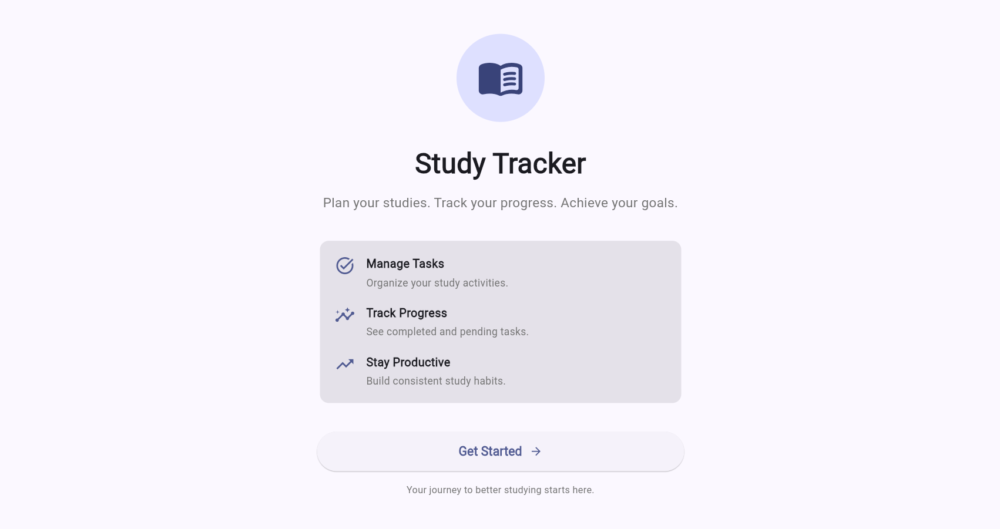
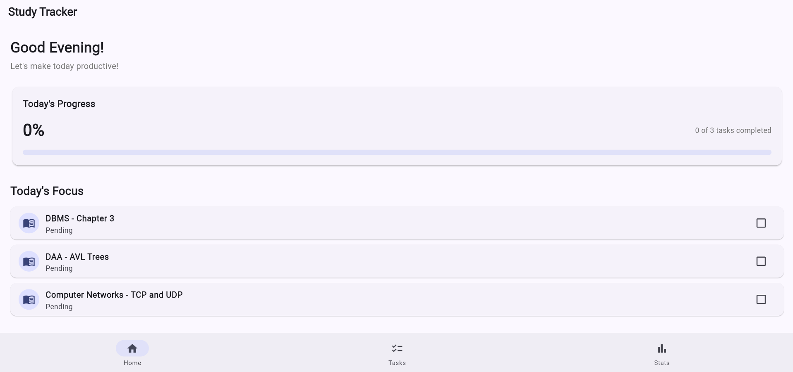
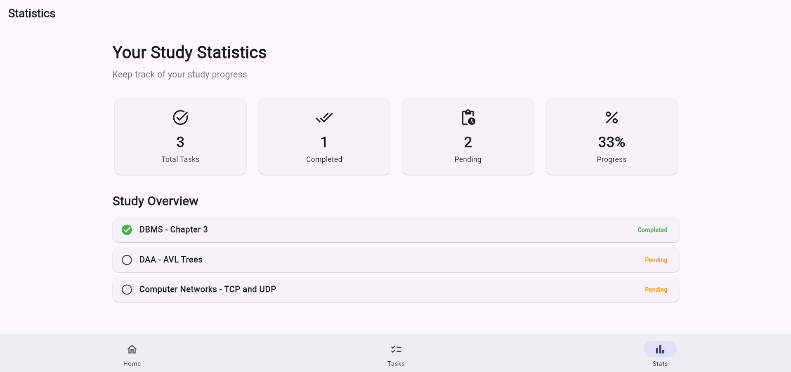
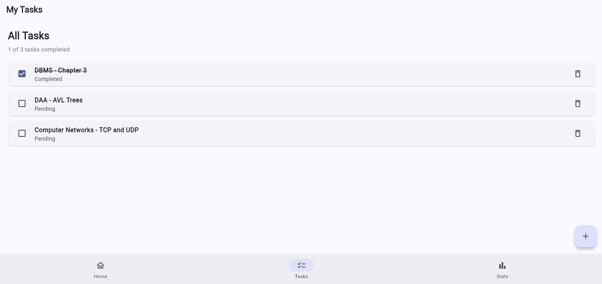
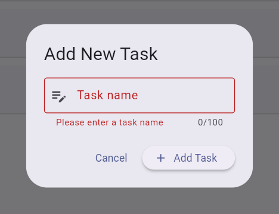
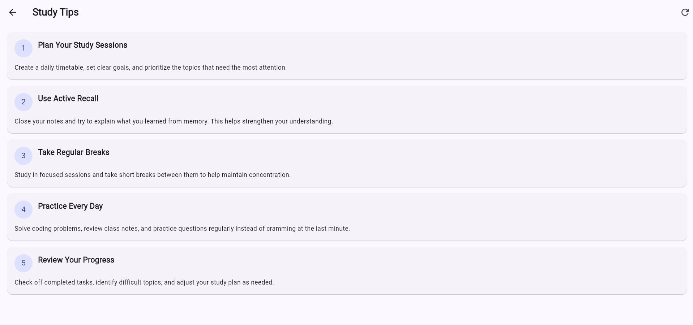

# Study Tracker App 📚

A Flutter-based Study Tracker application developed as part of the **Flutter Lab**. The app helps students manage study tasks, monitor their progress, and explore study tips fetched from a REST API.

**Live Demo:** [Study Tracker](https://srihith-2007.github.io/study_tracker/)

**GitHub Repository:** [study_tracker](https://github.com/SRIHITH-2007/study_tracker)

## 🚀 Features

- **Welcome Screen:** Animated introduction with navigation to the main application.
- **Task Management:** Add, complete, and delete study tasks.
- **Form Validation:** Prevents empty task entries and validates task titles.
- **State Management:** Uses the Provider package to manage task data and update the UI.
- **Statistics Dashboard:** Displays total, completed, and pending tasks with progress information.
- **Responsive UI:** Adapts the statistics layout to different screen widths using `MediaQuery` and `LayoutBuilder`.
- **Navigation:** Uses named routes and bottom navigation to access different screens.
- **Study Tips:** Fetches and displays data from a REST API with loading and error-handling states.
- **Themes and Styling:** Uses Material Design widgets, consistent styling, and a coordinated color theme.
- **Automated Testing:** Includes unit tests and widget tests for important application behavior.

## 🛠️ Technologies Used

- **Framework:** Flutter
- **Programming Language:** Dart
- **State Management:** Provider
- **Networking:** HTTP package
- **API:** JSONPlaceholder
- **UI Design:** Material Design
- **Testing:** Flutter Test
- **Version Control:** Git and GitHub
- **Deployment:** GitHub Pages

## 📋 Flutter Lab Experiments

The project incorporates concepts from the following 10 experiments:

| No. | Experiment | Implementation |
|---:|---|---|
| 1 | Introduction to Flutter and Dart Basics | Flutter application structure, Dart classes, and widgets |
| 2 | Flutter Widgets and Layouts | Row, Column, Stack, and Material widgets |
| 3 | Responsive UI Design | MediaQuery and LayoutBuilder for adaptive layouts |
| 4 | Navigation | Navigator, named routes, and bottom navigation |
| 5 | State Management | Stateful and Stateless widgets, setState, and Provider |
| 6 | Custom Widgets, Themes, and Styling | Reusable UI components, Material theme, and styling |
| 7 | Forms, Validation, and Error Handling | Task entry form and input validation |
| 8 | Animations in Flutter | Fade and slide animations on the welcome screen |
| 9 | REST API Integration | HTTP requests, JSON parsing, and Study Tips display |
| 10 | Testing and Debugging | Provider unit tests, widget tests, and Flutter analysis |


---

# Flutter Lab Experiments

The following sections document all 10 experiments in one README. Each section includes its aim, key concepts, a code snippet from the project, and the related application screenshot where available. The snippets are excerpts, not separate runnable applications; run the complete project to see the output.

## Experiment 1: Introduction to Flutter and Dart Basics

**Aim:** Understand the Flutter project structure, Dart entry point, classes, and widgets.

**Concepts:** `main()`, `runApp()`, classes, constructors, `StatelessWidget`, and `MaterialApp`.

**Code – `lib/main.dart`:**

```dart
void main() {
  runApp(
    ChangeNotifierProvider(
      create: (_) => TaskProvider(),
      child: const StudyTrackerApp(),
    ),
  );
}

class StudyTrackerApp extends StatelessWidget {
  const StudyTrackerApp({super.key});

  @override
  Widget build(BuildContext context) {
    return MaterialApp(
      title: 'Study Tracker',
      theme: ThemeData(
        colorScheme: ColorScheme.fromSeed(seedColor: Colors.indigo),
        useMaterial3: true,
      ),
      initialRoute: '/',
    );
  }
}
```

**Output:**



**Result:** The Flutter application starts through `main()` and displays its UI using the widget tree.

## Experiment 2: Flutter Widgets and Layouts

**Aim:** Build screens by arranging Flutter widgets.

**Concepts:** `Scaffold`, `AppBar`, `Column`, `Row`, `Card`, `Padding`, and `Text`.

**Code – layout example:**

```dart
Scaffold(
  appBar: AppBar(title: const Text('Study Tracker')),
  body: Padding(
    padding: const EdgeInsets.all(16),
    child: Column(
      crossAxisAlignment: CrossAxisAlignment.start,
      children: [
        const Text('Welcome back!'),
        const SizedBox(height: 16),
        Card(
          child: Padding(
            padding: const EdgeInsets.all(16),
            child: Row(
              children: const [
                Icon(Icons.menu_book),
                SizedBox(width: 12),
                Text('Your study progress'),
              ],
            ),
          ),
        ),
      ],
    ),
  ),
)
```

**Output:**



**Result:** Flutter layout and Material widgets are used to arrange the application screen.

## Experiment 3: Responsive UI Design

**Aim:** Make the application layout adapt to different screen sizes.

**Concepts:** `MediaQuery`, `LayoutBuilder`, constraints, and responsive layout decisions.

**Code – responsive layout pattern:**

```dart
LayoutBuilder(
  builder: (context, constraints) {
    final isWide = constraints.maxWidth >= 600;

    return GridView.count(
      crossAxisCount: isWide ? 3 : 1,
      shrinkWrap: true,
      physics: const NeverScrollableScrollPhysics(),
      children: [
        // Place dashboard statistic cards here.
      ],
    );
  },
)
```

**Output:**



**Result:** The dashboard layout can change according to the available screen width.

## Experiment 4: Navigation in Flutter

**Aim:** Move between application screens.

**Concepts:** Named routes, `MaterialApp.routes`, `Navigator`, and bottom navigation.

**Code – named routes from `lib/main.dart`:**

```dart
MaterialApp(
  initialRoute: '/',
  routes: {
    '/': (context) => const WelcomeScreen(),
    '/home': (context) => const MainScreen(),
    '/tasks': (context) => const TasksScreen(),
    '/statistics': (context) => const StatisticsScreen(),
    '/study-tips': (context) => const StudyTipsScreen(),
  },
)
```

**Code – opening a route:**

```dart
Navigator.pushNamed(context, '/tasks');
```

**Output:**


**Result:** Named routes provide navigation between the main application screens.

## Experiment 5: State Management

**Aim:** Manage task data and update the UI when data changes.

**Concepts:** `ChangeNotifier`, Provider, `notifyListeners()`, and `Consumer`.

**Code – Provider pattern:**

```dart
class TaskProvider extends ChangeNotifier {
  final List<StudyTask> _tasks = [];

  List<StudyTask> get tasks => List.unmodifiable(_tasks);

  void addTask(StudyTask task) {
    _tasks.add(task);
    notifyListeners();
  }

  void deleteTask(int index) {
    _tasks.removeAt(index);
    notifyListeners();
  }
}
```

**Output:**



**Result:** Provider notifies listening widgets when task data changes so the UI can refresh.

## Experiment 6: Custom Widgets, Themes, and Styling

**Aim:** Reuse UI components and apply a consistent application theme.

**Concepts:** Custom widgets, constructors, `ThemeData`, `Card`, and `TextStyle`.

**Code – reusable widget pattern:**

```dart
class ProgressCard extends StatelessWidget {
  final String title;
  final String value;
  final IconData icon;

  const ProgressCard({
    super.key,
    required this.title,
    required this.value,
    required this.icon,
  });

  @override
  Widget build(BuildContext context) {
    return Card(
      child: ListTile(
        leading: Icon(icon),
        title: Text(title),
        subtitle: Text(value),
      ),
    );
  }
}
```

**Output:**


**Result:** Reusable widgets and theme settings help maintain a consistent UI.

## Experiment 7: Forms, Validation, and Error Handling

**Aim:** Accept task details and validate user input.

**Concepts:** `Form`, `GlobalKey<FormState>`, `TextFormField`, validators, and error messages.

**Code – form validation pattern:**

```dart
final formKey = GlobalKey<FormState>();

Form(
  key: formKey,
  child: TextFormField(
    decoration: const InputDecoration(
      labelText: 'Task title',
      border: OutlineInputBorder(),
    ),
    validator: (value) {
      if (value == null || value.trim().isEmpty) {
        return 'Please enter a task title';
      }
      return null;
    },
  ),
)

// Validate before saving:
if (formKey.currentState!.validate()) {
  // Save the valid task.
}
```

**Output:**



**Result:** The form displays a validation message when the task title is empty.

## Experiment 8: Animations in Flutter

**Aim:** Add animation to improve the welcome screen experience.

**Concepts:** Animation controller, fade transition, slide transition, and animation lifecycle.

**Code – transition pattern:**

```dart
FadeTransition(
  opacity: animation,
  child: SlideTransition(
    position: slideAnimation,
    child: const Text('Welcome to Study Tracker'),
  ),
)
```

**Output:**


**Result:** Fade and slide transitions provide animated entry for welcome-screen content.

## Experiment 9: REST API Integration

**Aim:** Retrieve study-tip data from a REST API and display it in the application.

**Concepts:** HTTP GET, asynchronous programming, JSON decoding, and error handling.

**Code – API request pattern:**

```dart
final response = await http.get(
  Uri.parse('https://jsonplaceholder.typicode.com/posts'),
);

if (response.statusCode == 200) {
  final List<dynamic> data = jsonDecode(response.body);
  // Convert the returned JSON items into application data.
} else {
  throw Exception('Failed to load study tips');
}
```

**Output:**



**Result:** The application retrieves remote data and presents study tips, with loading and error states handled by the screen.

## Experiment 10: Testing and Debugging

**Aim:** Check application behavior and identify errors using Flutter's testing and analysis tools.

**Concepts:** Unit testing, widget testing, mocked API responses, and static analysis.

**Code – unit test pattern:**

```dart
test('adding a task updates the task list', () {
  final provider = TaskProvider();
  final task = StudyTask(
    // Use the required fields from the project's StudyTask model.
  );

  provider.addTask(task);

  expect(provider.tasks, contains(task));
});
```

**Testing commands:**

```bash
flutter analyze
flutter test
flutter test test/task_provider_test.dart
flutter test test/widget_test.dart
flutter test test/study_tips_service_test.dart
```

**Output:** No separate test-run screenshot was included in the supplied project screenshots. Run the commands above in the project terminal to view the current test results.

**Result:** Flutter analysis and automated tests help identify code issues and verify selected application behavior.

---

## ⚙️ Getting Started

### Prerequisites

Install the following before running the project:

- Flutter SDK
- Dart SDK (included with Flutter)
- Visual Studio Code or Android Studio
- Chrome for running the web version

### Installation

1. Clone the repository:

   ```bash
   git clone https://github.com/SRIHITH-2007/study_tracker.git
   ```

2. Navigate to the project directory:

   ```bash
   cd study_tracker
   ```

3. Install dependencies:

   ```bash
   flutter pub get
   ```

4. Run the application in Chrome:

   ```bash
   flutter run -d chrome
   ```

## 🧪 Testing and Debugging

Run the static analyzer:

```bash
flutter analyze
```

Run all automated tests:

```bash
flutter test
```

Run the Provider unit tests:

```bash
flutter test test/task_provider_test.dart
```

Run the widget tests:

```bash
flutter test test/widget_test.dart
```

Run the Study Tips API-related tests:

```bash
flutter test test/study_tips_service_test.dart
```

These tests cover selected task-management operations, navigation behavior, JSON parsing, and mocked HTTP responses.

## 📸 Screenshots

### Welcome Screen


### Home Screen


### Task Management


### Statistics Dashboard


### Study Tips


### Task Form Validation


## 📂 Project Structure

```text
study_tracker/
├── lib/
│   ├── data/
│   ├── models/
│   ├── providers/
│   ├── screens/
│   ├── services/
│   └── main.dart
├── test/
│   ├── widget_test.dart
│   ├── task_provider_test.dart
│   └── study_tips_service_test.dart
├── .github/
│   └── workflows/
├── pubspec.yaml
└── README.md
```

## 🎯 Learning Outcomes

Through this project, the following concepts are practiced:

- Building user interfaces with Flutter and Dart
- Managing application state using Provider
- Navigating between screens using named routes
- Designing responsive layouts
- Validating user input
- Implementing basic Flutter animations
- Fetching and parsing REST API data
- Writing unit and widget tests
- Debugging and analyzing Flutter applications
- Managing source code with Git and GitHub

## 👨‍💻 Author

**Srihith**

B.Tech — Computer Science and Engineering

## 📄 License

This project was developed for educational and academic purposes.